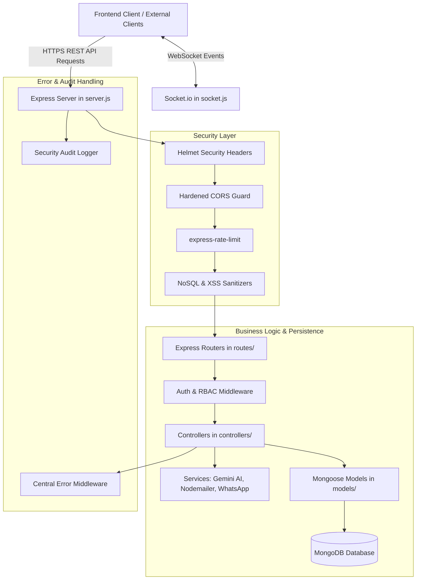

# 01 - Backend Architecture Overview

This document describes the architectural design, core responsibilities, request lifecycle, and data flow of the SchoolSphere backend application.

---

## 1. System Purpose & Architecture

The **SchoolSphere Backend** is a production-grade RESTful API server and real-time WebSocket communication hub. It is engineered using modern Node.js ECMAScript Modules (`import`/`export`), Express.js, MongoDB/Mongoose, and Socket.io.



---

## 2. Core Responsibilities

1. **Identity & Access Management (IAM)**:
   - Stateless JWT issuance, verification, and revocation via `tokenVersion`.
   - Brute-force account lockout (locks account for 15 minutes after 5 failed attempts).
   - Multi-tier Role-Based Access Control (Super Admin, Principal, Teacher, Parent, Student).
2. **Academic & Operational Data Persistence**:
   - Manages students, attendance, homework submissions, grades, exam schedules, transport routes, and staff payroll via indexed Mongoose schemas.
3. **Generative Pedagogical AI (Gemini 1.5 Flash)**:
   - On-demand generation of curriculum-aligned examination questions, multiple-choice options, correct answers, and explanations.
   - Intelligent multilingual context-aware conversational assistant (supporting English, Hindi, Urdu, Roman Urdu, and Hinglish).
4. **Real-Time Notification & Messaging Pipeline**:
   - WebSocket instant chat between institutional members.
   - Automated email dispatch (Nodemailer) and WhatsApp alerts (Baileys) for attendance absentees and overdue fees.
5. **Defensive Cybersecurity Layer**:
   - Zero-trust input sanitization (strips MongoDB `$` operators and dangerous script tags).
   - Sensitive data redactor preventing password hashes or `__v` from leaking in responses.
   - Comprehensive file upload verification rejecting scripts, executables, and HTML files.

---

## 3. Request / Response Lifecycle

Every HTTP request traverses the following ordered stages:

```text
1. INCOMING REQUEST
   ↓
2. ANTI-FINGERPRINTING: app.disable('x-powered-by')
   ↓
3. HELMET & ENTERPRISE HEADERS: X-Content-Type-Options, HSTS, Permissions-Policy, COOP
   ↓
4. CORS VALIDATION: Strict origin whitelisting against FRONTEND_URL
   ↓
5. RATE LIMITING: Global IP limiter (1,000 req/15 min) + Auth limiter (15 req/15 min)
   ↓
6. BODY PARSING: express.json({ limit: '2mb' }) to prevent memory exhaustion DoS
   ↓
7. SECURITY SANITIZERS:
   - sanitizeNoSQL: Recursively strips keys starting with '$' or containing '.'
   - sanitizeXSS: Strips <script>, javascript: pseudo-protocols, and inline event handlers
   - preventParameterPollution: Flattens duplicated query arrays
   - sanitizeRegexSearch: Escapes ReDoS special characters
   ↓
8. ROUTE MATCHING & AUTHENTICATION:
   - protect middleware verifies JWT signature, expiration, and tokenVersion
   - authorizeRoles middleware enforces RBAC permissions
   ↓
9. CONTROLLER EXECUTION:
   - Business logic, validation, and Mongoose database operations
   ↓
10. SENSITIVE DATA REDACTION: Strips password and internal versioning
   ↓
11. STANDARDIZED API RESPONSE: { success: true, message, data }
   ↓
12. CENTRALIZED ERROR HANDLING: Catches Mongoose CastError, duplicate keys, returns safe error JSON
```
