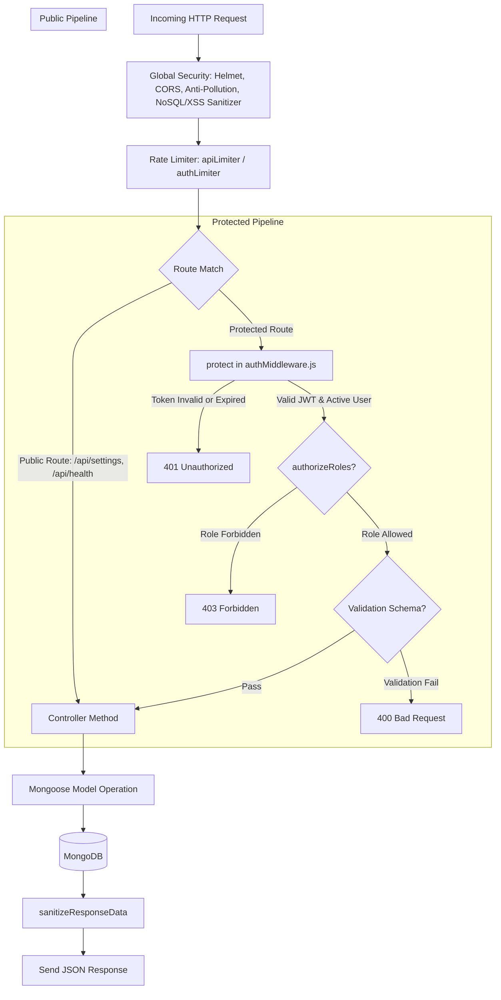

# 05 - Backend Routing and Request Pipeline

This document details how Express routes are mounted, prefixed, guarded by middleware chains, and mapped to controllers in the SchoolSphere backend.

---

## 1. Route Mounting Architecture

All application endpoints are declared in `backend/routes/` and mounted in `backend/server.js` under the `/api` prefix:

```javascript
// server.js Route Registrations
app.use('/api/auth', authRoutes);
app.use('/api/users', userRoutes);
app.use('/api/students', studentRoutes);
app.use('/api/attendance', attendanceRoutes);
app.use('/api/fees', feeRoutes);
app.use('/api/homework', homeworkRoutes);
app.use('/api/chat', chatRoutes);
app.use('/api/exams', examRoutes);
app.use('/api/transport', transportRoutes);
app.use('/api/payroll', payrollRoutes);
app.use('/api/notices', noticeRoutes);
app.use('/api/settings', settingRoutes);
app.use('/api/upload', uploadRoutes);
app.use('/api/communication', communicationRoutes);
```

---

## 2. Middleware Chain & Execution Flow

When an HTTP request strikes an endpoint, it moves through an Express middleware pipeline:



---

## 3. Router Composition Patterns

The codebase employs standard Express REST route composition patterns:

### Pattern A: Standard CRUD with `.route()` Chaining
Found in `userRoutes.js`, `studentRoutes.js`, `noticeRoutes.js`:
```javascript
router.use(protect); // Applies authentication to all routes in this file

router.route('/')
  .get(getAllStudents)
  .post(authorizeRoles('super_admin', 'principal'), createStudent);

router.route('/:id')
  .get(getStudentById)
  .put(authorizeRoles('super_admin', 'principal', 'teacher'), updateStudent)
  .delete(authorizeRoles('super_admin'), deleteStudent);
```

### Pattern B: Module-Wide Role Lockdown
Found in `payrollRoutes.js`:
```javascript
router.use(protect);
// Module-level lockdown: only super_admin and principal can invoke ANY route in this file
router.use(authorizeRoles('super_admin', 'principal'));

router.get('/stats/overview', getPayrollStats);
router.route('/').get(getAllPayrolls).post(createOrUpdatePayroll);
router.put('/:id/pay', markPayrollAsPaid);
```

### Pattern C: Public Read, Guarded Write
Found in `settingRoutes.js`:
```javascript
// Publicly readable for school branding (even on login page)
router.get('/', getSettings);

// Guarded modification
router.put('/', protect, authorizeRoles('super_admin', 'principal'), updateSettings);
```
