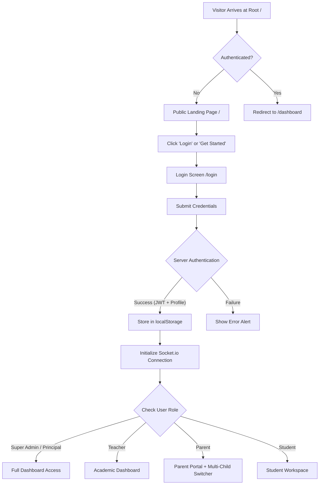

# 01 - Frontend Project Overview

## 1. Executive Summary

The **SchoolSphere Frontend** is a modern, single-page web application (SPA) built to deliver an enterprise-grade digital campus portal for K-12 schools, academies, and collegiate institutions.

The user interface serves five distinct user personas:
1. **Super Admin** (Full administrative, operational, academic, financial, and configuration authority)
2. **Principal** (Academic executive oversight, teacher/student/parent directories, approvals, and payroll reporting)
3. **Teacher** (Daily roll-call attendance, homework assignment and grading, exam authoring, AI paper generation)
4. **Parent** (Multi-child switcher, fee invoices and receipt downloads, attendance records, teacher chat)
5. **Student** (Student dashboard, timetable, assigned homework submissions, exam schedule, report cards)

---

## 2. Core Functional Modules

The application is structured into the following operational pillars:

### A. Academic & Community Management
- **Student Information System (SIS)**: Searchable, filterable student registry with roll numbers, grade/section filtering, parent linkages, and Excel export.
- **Teacher Directory**: Faculty listing with qualification, phone, email, and departmental assignment.
- **Parent Directory & Multi-Child Linking**: Parental contact directory supporting multi-sibling household relationships.
- **Daily Attendance Engine**: Real-time roll-call grid allowing teachers to mark Present, Absent, Late, or Leave in bulk with summary metrics.
- **Digital Homework Portal**: Interactive homework assignments with deadline countdowns, document attachments, student submission uploads, and teacher grade/remarks.

### B. Examination & Pedagogical AI
- **Exam Management**: Comprehensive schedule of Mid-Term, Final, Unit Tests, and Practical assessments with room allocations and pass/fail thresholds.
- **AI Exam Studio (Google Gemini 1.5 Flash)**: Automated pedagogical question generator allowing teachers to select Class, Subject, Topic, Difficulty (Easy, Medium, Hard), and quantity (1–30 questions) to produce curriculum-aligned MCQs with answer keys and explanations.
- **Student Report Cards**: Visual grade distributions and cumulative performance summaries.

### C. Finance, Logistics & Operations
- **Fee Management & Invoicing**: Comprehensive tuition, laboratory, sports, examination, and transport fee ledger with installment tracking, remaining balance calculation, and printable fee receipts.
- **Fleet & Transport Tracking**: Bus and van route manager with vehicle numbers, driver phone contacts, vehicle passenger capacity, and staged pickup stops.
- **Institutional Payroll**: Staff payroll records detailing base pay, allowances, deductions, net salary calculation, and payment status tracking.

### D. Communication, Notifications & Real-Time Engagement
- **Live Institutional Chat (Socket.io)**: Instant two-way messaging between parents, teachers, and administrators with auto-reconnection and active online status.
- **Multi-Channel Dispatch (Email & WhatsApp)**: Automated and manual broadcast center powered by Nodemailer (SMTP) and Baileys WhatsApp Web automation.
- **Campus Bulletin & Notice Board**: Filterable board for urgent announcements, academic calendar dates, holidays, and campus events.

### E. Configuration & Profile
- **Institutional Branding & Settings**: Dynamic school identity configuration (School Name, Motto, Address, Phone, Email, Academic Session, Currency).
- **User Profile Management**: Self-service profile updating (avatar/photo, phone number, password change).

---

## 3. Technology Stack Summary

| Layer | Implementation | Verified Version |
| :--- | :--- | :--- |
| **Framework** | React (Hooks, Context, Functional Components) | 18.3.1 |
| **Build Tool** | Vite | 6.0.7 |
| **Client Routing** | React Router DOM | 6.28.0 |
| **Styling** | Tailwind CSS + PostCSS + Autoprefixer | 3.4.17 |
| **Icons** | Lucide React | 0.469.0 |
| **HTTP Client** | Axios | 1.7.9 |
| **Realtime WebSockets** | Socket.io Client | 4.8.1 |
| **Charts & Analytics** | Recharts | 2.15.0 |
| **Spreadsheet Export** | SheetJS (xlsx) | 0.18.5 |

---

## 4. Primary User Flows

