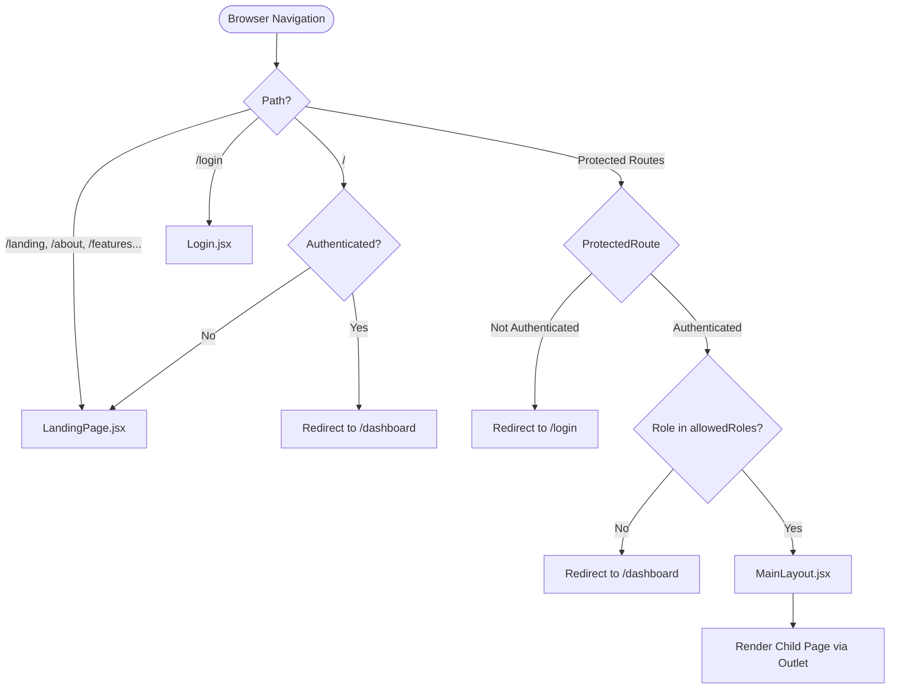

# 04 - Frontend Pages and Routing Directory

This document details all routes, page views, access control guards, and navigation flows implemented in `frontend/src/App.jsx`.

---

## 1. Routing Architecture & Route Guards

The routing system uses **React Router DOM v6** with declarative nested routes and custom Route Guards:

### Route Guard Implementations:
1. **`RootRoute`**: Intercepts `/`. If user is authenticated, redirects to `/dashboard`. If unauthenticated, displays public marketing `LandingPage`.
2. **`ProtectedRoute`**: Evaluates `isAuthenticated` and `role` against an optional `allowedRoles` array. If unauthenticated, redirects to `/login` with `state: { from: location }` to allow post-login return. If role is unauthorized, redirects safely to `/dashboard`.

---

## 2. Comprehensive Route Map

| Path | Component | Layout | Allowed Roles | Description & Primary Actions |
| :--- | :--- | :--- | :--- | :--- |
| `/` | `RootRoute` | None | Public | Contextual root. Directs logged-in users to `/dashboard` and visitors to `LandingPage`. |
| `/landing` | `LandingPage` | None | Public | Full institutional promotional landing page with features showcase, stats, and testimonials. |
| `/about` | `LandingPage` | None | Public | Anchor alias pointing to institutional mission and accreditation details. |
| `/features` | `LandingPage` | None | Public | Anchor alias displaying the 12 core academic management modules. |
| `/modules` | `LandingPage` | None | Public | Anchor alias showing module breakdown. |
| `/why-us` | `LandingPage` | None | Public | Anchor alias for competitive advantages. |
| `/contact` | `LandingPage` | None | Public | Anchor alias for admissions contact form. |
| `/login` | `Login` | None | Public | Secure institutional login screen. Auto-redirects to `/dashboard` if user is already logged in. |
| `/dashboard` | `Dashboard` | `MainLayout` | All Roles | Role-customized analytics overview, attendance KPIs, fee collection charts, and action hubs. |
| `/students` | `Students` | `MainLayout` | `super_admin`, `principal`, `teacher` | Student directory, admissions enrollment modal, grade/section filtering, and Excel export. |
| `/parents` | `Parents` | `MainLayout` | `super_admin`, `principal` | Parent directory, multi-child parent links, emergency contacts, and account statuses. |
| `/teachers` | `Teachers` | `MainLayout` | `super_admin`, `principal` | Faculty registry, department allocations, qualifications, and teacher account creations. |
| `/attendance` | `Attendance` | `MainLayout` | All Roles | Bulk roll-call attendance sheet for teachers; attendance history summary for parents and students. |
| `/fees` | `Fees` | `MainLayout` | `super_admin`, `principal`, `parent` | Tuition ledger, record manual payments, outstanding balance tracking, and printable receipts. |
| `/homework` | `Homework` | `MainLayout` | All Roles | Create assignments with attachments (teachers), upload submissions (students), review grades (parents). |
| `/exams` | `Exams` | `MainLayout` | All Roles | Examination schedules, room allocations, practical timings, marks entry, and report cards. |
| `/ai-exam-generator` | `AIExamGenerator` | `MainLayout` | `super_admin`, `principal`, `teacher` | Gemini 1.5 Flash AI paper generator: creates curriculum MCQs, answers, and explanations. |
| `/transport` | `Transport` | `MainLayout` | `super_admin`, `principal`, `parent`, `student` | Bus/van fleet route roster, pickup stop locations, driver contacts, and assigned students. |
| `/payroll` | `Payroll` | `MainLayout` | `super_admin`, `principal` | Staff salary processing, allowances, deductions, net pay calculation, and payment status. |
| `/chat` | `Chat` | `MainLayout` | All Roles | Live WebSocket two-way instant messaging between parents, teachers, and administration. |
| `/notices` | `Notices` | `MainLayout` | All Roles | Academic circulars, holiday announcements, campus events, and role-targeted notifications. |
| `/communications` | `Communications` | `MainLayout` | `super_admin`, `principal`, `teacher` | Multi-channel broadcast hub: dispatch automated or custom notifications via Email & WhatsApp. |
| `/reports` | `Reports` | `MainLayout` | `super_admin`, `principal` | Comprehensive visual institutional audit: attendance trends, finance realization, and student growth. |
| `/settings` | `Settings` | `MainLayout` | `super_admin`, `principal` | Global school identity: institution name, motto, logo URL, address, contact email, and currency. |
| `/profile` | `Profile` | `MainLayout` | All Roles | Current user self-service: update display name, phone number, profile photo, and change password. |
| `*` | Fallback | None | Public | Catch-all wildcard redirecting unknown URLs back to `/`. |
