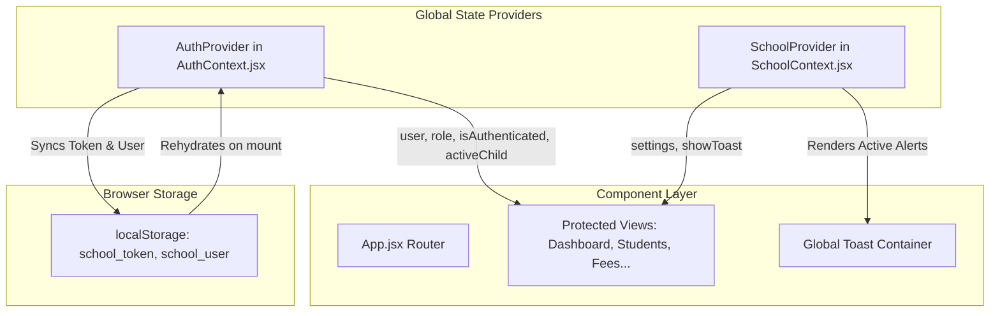

# 07 - Frontend State Management Architecture

This document describes how state is managed across the SchoolSphere frontend, covering React Context providers, local component state, persistent storage synchronization, and data flow.

---

## 1. State Layer Architecture

Rather than introducing heavy Redux boilerplate for a moderate-scale portal, the frontend utilizes **React Context API** for global domain state and standard **React Hooks (`useState`, `useReducer`, `useEffect`)** for component-level interaction state.



---

## 2. Context Providers

### A. `AuthContext` (`src/context/AuthContext.jsx`)
Manages authentication lifecycle, JWT token persistence, and parent-child association.

#### Exposed Values & Methods:
| Property / Method | Type | Description |
| :--- | :--- | :--- |
| `user` | `Object \| null` | Authenticated user profile (`id`, `name`, `email`, `role`, `profileImage`, `phone`). |
| `token` | `string \| null` | JSON Web Token (JWT) string used for `Authorization: Bearer <token>`. |
| `role` | `string` | Role shortcut (`'super_admin'`, `'principal'`, `'teacher'`, `'parent'`, `'student'`). |
| `isAuthenticated` | `boolean` | `true` if valid token and user profile exist in memory. |
| `loading` | `boolean` | `true` during initial token verification or active login request. |
| `login(email, password)` | `async function` | Authenticates against `/api/auth/login`, updates state and `localStorage`. |
| `logout()` | `function` | Clears memory state, purges `localStorage`, disconnects WebSocket. |
| `childrenList` | `Array<Object>` | Enrolled children linked to the logged-in parent user. |
| `activeChild` | `Object \| null` | Currently active child selected in the parent portal. |
| `switchActiveChild(child)`| `function` | Updates `activeChild` across all views. |
| `updateCurrentUser(data)` | `function` | Merges updated profile fields into current user state and storage. |

### B. `SchoolContext` (`src/context/SchoolContext.jsx`)
Manages institutional branding and transient system-wide toast notifications.

#### Exposed Values & Methods:
| Property / Method | Type | Description |
| :--- | :--- | :--- |
| `settings` | `Object` | Dynamic institution configuration (`schoolName`, `schoolMotto`, `phone`, `email`, `academicYear`, `currency`, `logoUrl`). |
| `updateSchoolSettings(data)` | `async function` | Updates institutional branding via `/api/settings`. |
| `showToast(msg, type, title)`| `function` | Triggers a floating toast (`'success'`, `'error'`, `'info'`) auto-dismissed after 4.5 seconds. |
| `toasts` | `Array<Object>` | Active queue of displayed toast notifications. |
| `removeToast(id)` | `function` | Manually dismisses a toast notification. |

---

## 3. Bidirectional Data Flow Lifecycle

Every user action follows this predictable unidirectional flow:

```text
USER ACTION (e.g. User submits attendance or creates homework)
   ↓
COMPONENT FORM / EVENT HANDLER (Validates inputs, sets loading=true)
   ↓
API SERVICE CALL (api.js passes sanitized payload + Bearer token)
   ↓
BACKEND REST CONTROLLER (Express validates, updates MongoDB)
   ↓
RESPONSE PAYLOAD (Status 200/201 with updated resource)
   ↓
REACT STATE UPDATE (Component updates local state or triggers showToast)
   ↓
UI RE-RENDER (DOM displays new data, closes modal, dismisses spinner)
```
