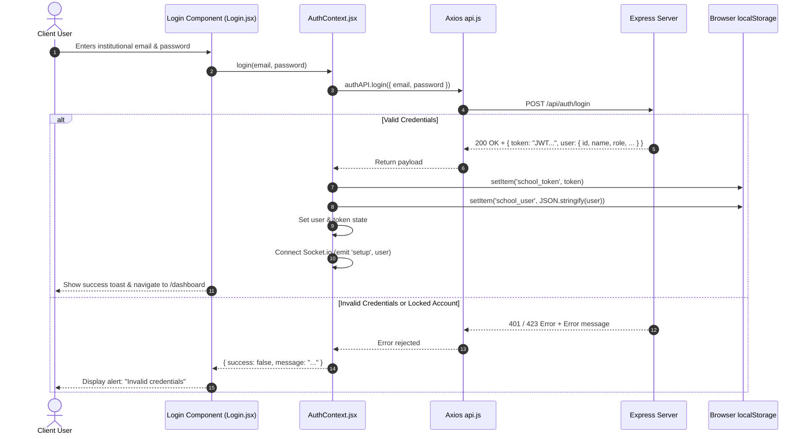

# 09 - Frontend Authentication and Authorization Architecture

This document provides a technical walkthrough of the authentication and Role-Based Access Control (RBAC) mechanisms implemented in the SchoolSphere frontend.

---

## 1. Authentication Lifecycle

The authentication system is built around stateless **JSON Web Tokens (JWT)** generated by the backend and persisted on the client.



---

## 2. Token Storage & Lifecycle

- **Storage Medium**: `window.localStorage`
  - Key `school_token`: Raw JWT string used for API headers.
  - Key `school_user`: Serialized JSON representation of the current user profile.
- **Header Injection**: Handled automatically by Axios request interceptor (`Authorization: Bearer <school_token>`).
- **Session Rehydration**: On page reload, `AuthContext` initializes `user` and `token` from `localStorage`, and makes an immediate call to `GET /api/auth/me` to verify validity against active server state.
- **Silent Session Termination**: If the token has expired, or if the user's password was changed on another device (which increments `tokenVersion`), the backend responds with `401 Unauthorized`. The Axios response interceptor immediately cleans `localStorage` and routes the browser to `/login?expired=true`.

---

## 3. Role-Based Access Control (RBAC)

The application enforces a strict five-tier role hierarchy:

| Role String | Description | Permitted Route Scopes |
| :--- | :--- | :--- |
| `super_admin` | Global Institutional Administrator | All routes, user administration, settings, financial audits, payroll, full read/write across all modules. |
| `principal` | Academic Dean / School Headmaster | Teachers, parents, students, attendance, homework, exams, transport, payroll, reports, and settings. |
| `teacher` | Academic Faculty | Students, attendance marking, homework creation & grading, exams, AI exam studio, chat, communications. |
| `parent` | Student Parent / Guardian | Multi-child switcher, attendance history, fee payment & receipts, homework tracking, teacher chat, transport. |
| `student` | Enrolled Scholar | Personal student dashboard, attendance records, homework submissions, exam schedule, report cards, chat. |

### Component & Route Level Protection

1. **Route-Level Guarding (`ProtectedRoute`)**:
   ```jsx
   <Route
     path="/payroll"
     element={
       <ProtectedRoute allowedRoles={['super_admin', 'principal']}>
         <Payroll />
       </ProtectedRoute>
     }
   />
   ```
   If a user lacks the required role, they are redirected to `/dashboard`.

2. **Navigation-Level Filtering (`Sidebar.jsx`)**:
   Navigation links are conditionally filtered before rendering:
   ```jsx
   const visibleItems = section.items.filter(item => item.roles.includes(role));
   ```
