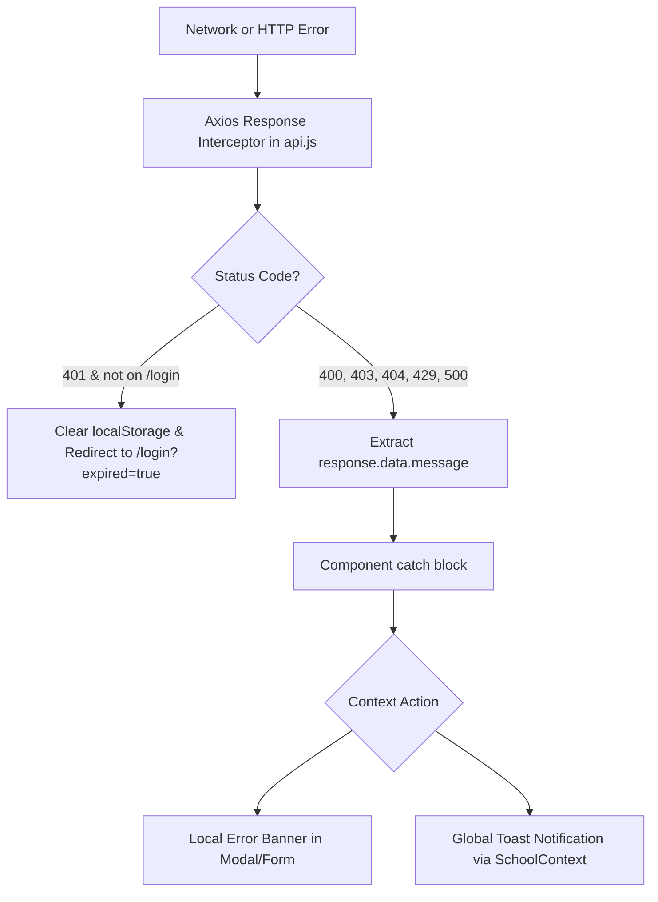

# 11 - Frontend Error Handling Architecture

This document describes how runtime exceptions, network failures, validation errors, and session expirations are caught, handled, and communicated to the user.

---

## 1. Multi-Tier Error Architecture



---

## 2. Global Toast Notification System

Implemented in `frontend/src/context/SchoolContext.jsx`. The system exposes `showToast(message, type, title)`:

- **Types Supported**:
  - `'success'` (Emerald green border, checkmark icon, positive confirmation)
  - `'error'` (Rose red border, cross icon, failure alert)
  - `'info'` (Cyan blue border, information icon, general updates)
- **Auto-Dismissal**: Automatically removes the notification after **4500ms** (4.5 seconds).
- **Manual Dismissal**: Each toast displays an interactive dismiss button (`removeToast`).
- **Rendering Container**: Placed at `fixed bottom-5 right-5 z-50` with pointer-events isolation so underlying buttons remain clickable.

---

## 3. Session Expiration & Invalidation Handling

When a user's session ends (either because 7 days have passed, the account was deactivated, or the password was changed), the backend sends a `401 Unauthorized` status.

In `frontend/src/services/api.js`:
```javascript
api.interceptors.response.use(
  (response) => response.data,
  (error) => {
    if (error.response?.status === 401 && !window.location.pathname.includes('/login')) {
      localStorage.removeItem('school_token');
      localStorage.removeItem('school_user');
      window.location.href = '/login?expired=true';
    }
    const message = error.response?.data?.message || error.message || 'An unexpected error occurred.';
    return Promise.reject(new Error(message));
  }
);
```

---

## 4. Empty and Loading States

- **Empty State (`EmptyState.jsx`)**: When a data table or list has 0 matching records, `EmptyState` renders an illustrative SVG icon, title (e.g., *"No students enrolled"*), and an optional call-to-action button to create the first record.
- **Loader (`Loader.jsx`)**: Displays an animated SVG spinner. Supports inline mode and full-screen overlay mode (`fullScreen={true}`) during route transitions or authentication verification.
